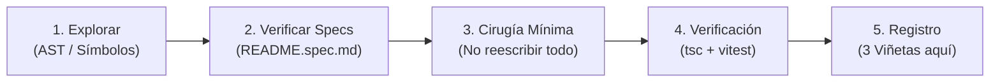

# 📋 DEV CHANGELOG & AGENT COLLABORATION GUIDELINES

Este documento es el registro compartido y la guía de actuación obligatoria para cualquier desarrollador o asistente de IA (**Antigravity, Cursor, Claude Code, OpenCode**) que intervenga en el repositorio `vetwebappprod`.

---

## 🧭 Estrategia SDD Ligera (Spec-Driven Development)

Para garantizar un estándar uniforme de calidad y evitar que nuevos cambios rompan código ya asentado y probado, todo agente o desarrollador debe seguir este ciclo:



1. **Inspección de impacto antes de editar:**
   - Ubicar los símbolos exactos antes de alterar archivos grandes. Evitar volcar miles de líneas al contexto.
   - Revisar los archivos de especificación relevantes (`features/*/README.spec.md`).
2. **Respetar contratos establecidos:**
   - Si una función o componente ya cuenta con tests en `__tests__/`, mantener intacta su firma pública y su compatibilidad hacia atrás.
3. **Cirugía mínima y precisa:**
   - Modificar únicamente las líneas requeridas. No reformatear archivos completos ni alterar lógicas no relacionadas con la tarea.
4. **Verificación Pre-Flight obligatoria:**
   - Ningún commit debe subirse sin antes ejecutar:
     ```bash
     npx tsc --noEmit
     npm test -- features/...
     ```
5. **Registro obligatorio de 3 viñetas:**
   - Al finalizar cada tarea, agregar una entrada en la sección **Historial de Cambios** respetando la plantilla de 3 viñetas.

---

## 📝 Plantilla de 3 Viñetas

Cada cambio debe documentarse cronológicamente con esta estructura:

```markdown
### [YYYY-MM-DD] <Título del Cambio> — (@Autor / IA)
- **Contexto / Problema:** Qué motivó el cambio o qué falla se resolvió.
- **Acción Realizada:** Módulos, componentes o APIs modificados y enfoque técnico.
- **Verificación:** Comandos ejecutados (`tsc`, `vitest`), rama y estado del deploy.
```

---

## 🪵 Historial de Cambios

### [2026-10-28] Auto-Advance Stage on Timer Expiration & Prompt Dismissal — (@Antigravity)
- **Contexto / Problema:** Al agotarse el temporizador de una etapa, si el banner de confirmación ("Did you finish the Diagnostic Planning?") estaba visible en pantalla, la simulación se quedaba bloqueada esperando una interacción manual.
- **Acción Realizada:** Se modificó el efecto de expiración en `features/live/components/live-session.tsx` para que, cuando el tiempo llega a cero, oculte inmediatamente el banner de confirmación (`setShowAdvanceConfirm(false)`), avance de etapa automáticamente mediante `handleConfirmAdvance()`, reactive el micrófono y reanude la simulación sin pausas forzadas.
- **Verificación:** TypeScript check sin errores (`tsc --noEmit`), suite de tests de `features/live` superada al 100% (65/65 tests) y sincronización en ramas.

### [2026-10-28] Gemini Live Token Analytics & Single Vercel Deploy Hook — (@Antigravity)
- **Contexto / Problema:** Se detectaron despliegues duplicados en `preview/educators` (disparados simultáneamente por la integración nativa de Vercel y el webhook de GitHub Actions), y el equipo requería capturar el consumo de tokens en Gemini Live para analítica y control de costos.
- **Acción Realizada:**
  1. Se ajustó `.github/workflows/deploy-preview.yml` a `workflow_dispatch` exclusivo, eliminando el trigger redundante de `push` y dejando a Vercel gestionar un solo build nativo.
  2. Se extendió `GeminiLiveService` y `useGeminiLive` para escuchar el evento `usageMetadata` emitido por el socket de Gemini Live (`promptTokenCount`, `candidatesTokenCount`).
  3. Se conectó `LiveSession` para enviar `promptTokens` y `completionTokens` en `PATCH /api/live/session`, persistiendo las métricas en la tabla `attempts` con fallback seguro ante columnas faltantes, y se creó la migración `db/add_token_tracking_to_attempts.sql`.
- **Verificación:** Type-check TypeScript aprobado (`tsc --noEmit`), 49 archivos de test pasando (`npm test`), y workflow validado.

### [2026-10-28] Unificación de Rutas a Gemini Live & Decomisión de Chat Antiguo — (@Antigravity)
- **Contexto / Problema:** Al unirse a una sesión educativa desde `/case-sessions`, los alumnos caían en el chat antiguo de mayo (`/case/[id]/attempt`) con el enfermero clásico Martin y sin audio en vivo, debido a un desacople entre el rediseño de sesiones y el nuevo motor Live.
- **Acción Realizada:**
  1. Se actualizó `JoinSessionDialog.tsx`, `attempt-card.tsx` y `attempts/[id]/page.tsx` para dirigir directamente a `/live/[id]?attempt=...&session=...`.
  2. Se convirtió `app/case/[id]/attempt/page.tsx` en una redirección automática permanente hacia `/live/[id]`, preservando todos los query params.
  3. Se adaptó `app/live/[id]/page.tsx` y `app/api/live/session/route.ts` para aceptar `attemptId` y `sessionId`, vinculando formalmente el intento a la sesión del profesor.
  4. Se decomisionó el monolito legacy `chat-interface.tsx` (5.000+ líneas reemplazadas por stub ligero).
- **Verificación:** Suite completa superada (185/185 tests unitarios en verde), sincronización de ramas `preview/educators`, `preview/redesign` y `main`.

### [2026-10-28] Anillo de Alerta 20s & Scaffolding de Razonamiento Clínico — (@Antigravity)
- **Contexto / Problema:** Los estudiantes no recibían un aviso visual llamativo antes de finalizar cada etapa del caso, y se requería guiar el razonamiento clínico según la dificultad del caso sin crear enfermeras redundantes.
- **Acción Realizada:**
  1. Se agregó el anillo rojo parpadeante con resplandor (`ring-4 ring-red-500 animate-pulse glow`) al contador en `features/live/components/live-controls.tsx` cuando restan $\le 20$ s.
  2. Se calibró el prompt de la enfermera en `features/role-info/services/roleInfoService.ts` para inyectar scaffolding reflexivo en casos de dificultad Easy/Medium.
  3. Se implementó el servicio `/api/admin/reassign-nurses` para migrar casos antiguos hacia enfermeras especialistas.
- **Verificación:** Tests de componentes y de integración intensiva de findings verificados localmente y desplegados en Vercel.
