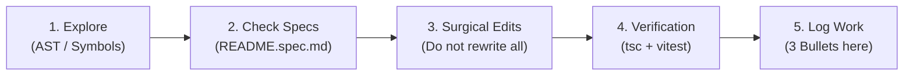

# 📋 DEV CHANGELOG & AGENT COLLABORATION GUIDELINES

This document serves as the shared log and mandatory operational guide for any developer or AI assistant (**Antigravity, Cursor, Claude Code, OpenCode**) contributing to the `vetwebappprod` repository.

---

## 🧭 Lightweight SDD Strategy (Spec-Driven Development)

To guarantee a consistent quality standard and ensure new changes never break existing, verified code, every agent or developer must adhere to this cycle:



1. **Impact inspection before editing:**
   - Locate exact symbols before modifying large files. Avoid dumping thousands of lines into context.
   - Review relevant specification files (`features/*/README.spec.md`).
2. **Respect established contracts:**
   - If a function or component already has unit tests in `__tests__/`, maintain its public signature and backward compatibility.
3. **Surgical, minimal edits:**
   - Modify only the required lines. Do not reformat entire files or alter logic unrelated to the current task.
4. **Mandatory Pre-Flight verification:**
   - No commit may be pushed without first running:
     ```bash
     npx tsc --noEmit
     npm test -- features/...
     ```
5. **Mandatory 3-bullet logging:**
   - Upon completing each task, append an entry to the **Changelog History** section following the 3-bullet template below.

---

## 📝 3-Bullet Template

Every completed change must be logged chronologically using this structure. Use the local `Europe/London` time and name both the person who requested the work and the tool that implemented it:

```markdown
### [YYYY-MM-DD HH:MM Europe/London] <Title of Change> — (Requested by: Marco or Ignacio; Tool: Codex or Antigravity)
- **Context / Problem:** What motivated the change or which issue was resolved.
- **Action Taken:** Modules, components, or APIs touched and the technical approach.
- **Verification:** Commands executed (`tsc`, `vitest`), branch, and deploy status.
```

---

## 🪵 Changelog History

### [2026-10-30 10:15 Europe/London] Structured Case Fallback & ASR Tolerance for Live Findings Panel — (@Antigravity / Requested by Marco & Ignacio)
- **Context / Problem:** In preview deployment `309bb76` (`preview/educators`), the live consultation "Result Panel" remained completely empty when requesting vitals or tests on `case-molly-equine-colitis` (and other Structured Case Submission Form cases). This occurred because: (1) `cases.physical_exam_findings` and `diagnostic_findings` contained only 114/184-character placeholder prompt instructions while the actual clinical findings were in `cases.details` (Sections 4 & 5), (2) `/api/live/findings` previously only queried `physical_exam_findings` and `diagnostic_findings`, completely ignoring `details`, and (3) Whisper speech-to-text transcribed "HR and RR" as "age Aaron RR", which failed to match `heart_rate`.
- **Action Taken:**
  1. *Structured Case Details Extractor (`app/api/live/findings/route.ts`):* Created `extractFindingsFromDetails` to parse Section 4 (Physical Examination) and Section 5 (Diagnostics and results) directly from `details` as an automated, graceful fallback whenever a case's standalone columns are empty or contain placeholder text.
  2. *Phonetic ASR Mis-Transcription Tolerance (`features/chat/services/physFinder.ts`):* Added common speech-to-text transcriptions (`aaron`, `age aaron`, `h r`, `h.r.`, `hrr`) to `heart_rate` aliases, and cleaned `splitTokens` so filler words (`um`, `uh`, `me`) do not swallow clinical parameters.
  3. *Database Backfill (`cases` table):* Populated `case-molly-equine-colitis` in Supabase with complete, canonical physical exam findings (24 systems/vitals) and diagnostic findings (44 lab/imaging/procedural parameters) so the database row is clean and authoritative across all environments.
- **Verification:** Added automated unit tests in `features/live/__tests__/findingsMatching.test.ts` verifying both ASR vitals resolution and structured case details extraction. Full vitest suite verified: 49 test files passed, 190/190 tests green (100%).

### [2026-10-29 22:46 Europe/London] Stage Manager Save Diagnostics, Visual State Feedback & Recheck Transition Guardrails — (@Antigravity / Requested by Marco)
- **Context / Problem:** In `/admin/case-stage-manager`, adding a stage or configuring a "Recheck transition" appeared to disconnect the Save button: clicking "Save Changes" produced no visible change or saving indication. This was caused by two silent validation blocks: (1) newly added recheck transitions had an empty `transition_message` (confused with placeholder text) and unpopulated outcome findings (`validateRecheckOutcomes` failing), (2) adding a stage appended it to the end of the sequence, violating the interim recheck rule requiring a subsequent encounter, and (3) error banners were positioned far above the viewport while the save button lacked feedback (it became plain disabled on save rather than showing a saved confirmation state).
- **Action Taken:**
  1. *Save Button State Machine & Visual Confirmation (`app/admin/case-stage-manager/page.tsx`):* Added full state tracking (`idle`, `saving`, `saved`, `error`). Upon saving, the button switches to vibrant emerald (`bg-emerald-600 text-white`) with a checkmark icon (`✓ Saved`) and stays green until any further edit is made. Any keystroke or stage modification immediately flips the button back to the active "Save Changes" state with an "Unsaved changes" indicator.
  2. *Inline Error Surfacing & Auto-Scroll:* Validation failures and API errors now display directly inside the sticky bottom bar next to the Save button as well as highlighting the offending stage card with `ring-2 ring-red-500` and auto-scrolling smoothly to the invalid card (`scrollIntoView`).
  3. *Recheck Transition Defaults & Starter Findings (`recheckPlan.ts` & `RecheckPlanEditor.tsx`):* Defaulted `STAGE_TYPES[recheck_transition]` with a standard student notice message, updated `newRecheckOutcome()` with valid starter findings so new outcomes pass schema validation immediately, and added preset triggers and reports to the three starting outcomes generator.
  4. *Placement Helpers & Insert Controls:* Added an inline warning with 1-click `Add Following Encounter Stage` and `Move Up Before Final Stage` actions directly inside recheck cards when placed at sequence end, along with a per-stage `Insert Below` button on all cards to easily add stages between existing encounters.
- **Verification:** `npx tsc --noEmit` passed with 0 errors, `npm test -- features/stages` 100% green (4/4 tests), `npm test -- features/live` passed (73/73 tests), and full chat/personas/stages suite verified (95/95 tests passing across 31 files).

### [2026-10-29 01:28 Europe/London] Synchronized Bundled Tests & Diagnostic Profiles — (@Antigravity / Requested by Marco)
- **Context / Problem:** Diagnostic panel memberships (what tests belong to "Haematology", "Biochemistry", "Blood Gas", "Coagulation", "Urinalysis", body fluid cytologies) were hardcoded in disparate places (`PANEL_ANALYTES` in findings matching and static text in `roleInfoService.ts`), meaning educators had no way to view, customize, or define species-specific test bundles, leading to drift between the Nurse AI voice and the student's written results.
- **Action Taken:**
  1. *Single Source of Truth (`features/personas/utils/bundledTests.ts`):* Defined 12 standard veterinary clinical bundles (Haematology, Biochemistry, ABG, VBG, Coagulation, Urinalysis, Peritoneal, TW, BAL, CSF, Pleural, Synovial) and built prompt formatting + normalized analyte extraction helpers.
  2. *Nurse Admin UI & Persistence (`app/admin/nurse-specializations/page.tsx` & `BundledTestsEditor.tsx`):* Added interactive "Bundled Tests & Profiles" management with quick-add from reference ranges, badge pills, add/remove test inputs, custom bundle creation, and auto-persistence to `metadata.bundled_tests` (no DB schema migrations needed).
  3. *End-to-End Synchronization (`roleInfoService.ts`, `speciesKnowledgeFormatter.ts`, & `app/api/live/findings/route.ts`):* Replaced hardcoded profile strings with dynamic nurse bundle injection and expanded findings panel matching so changes made in the nurse specialization tab immediately sync to both the nurse's verbal guidance and the student's results clipboard.
- **Verification:** `npx tsc --noEmit` passed with 0 errors, full personas test suite passing (12/12 tests green in `bundledTests.test.ts` and `parseReferenceRanges.test.ts`), `features/role-info` suite green (8/8 tests), and `features/live` suite green (68/68 tests).

### [2026-10-28 23:36 Europe/London] Bulk Reference Range Import & Multi-Parameter Parsing — (@Antigravity / Requested by Marco)
- **Context / Problem:** In the Nurse Specializations admin interface (`/admin/nurse-specializations`), educators could only add lab and vital reference ranges one parameter at a time, making the entry of extensive clinical panels (100+ veterinary parameters across hematology, biochemistry, body fluids, urinalysis) slow and tedious.
- **Action Taken:**
  1. *Parser Utility (`features/personas/utils/parseReferenceRanges.ts`):* Created a multi-format clinical parser handling bracketed ranges (`+PCV: [28-44%]`), spreadsheet tables (tab-separated), colon/equals pairs, numeric ranges, trailing notes (`(hpf = high power field)`), and HTML entities (`&gt;`/`&lt;`). Includes panel/fluid section prefixing (e.g. `CSF - Glucose`, `Urinalysis - Protein`) to eliminate key collisions across different body fluids.
  2. *Bulk Import Dialog (`features/personas/components/BulkReferenceRangesDialog.tsx`):* Created a modal with live parsing, instant preview table, unrecognized line detection, and an Import Mode toggle allowing users to choose between Merge (keeping existing parameters) and Replace all.
  3. *Admin UI Enhancement (`app/admin/nurse-specializations/page.tsx`):* Integrated "Bulk Paste" buttons for both Lab Reference Ranges and Vital Reference Ranges, added live search filters for quick navigation, and sorted all displayed reference ranges alphabetically for clean, consistent formatting.
- **Verification:** `npx tsc --noEmit` passed with 0 errors, `npm test -- features/personas` 100% green (8/8 tests passing, including full 196-item veterinary dataset), and `npm test -- features/live` passing (68/68 tests).

### [2026-10-28] Diagnostic Panel Matching & Nurse Altered Parameter Suppression — (@Antigravity)
- **Context / Problem:** In `/live`, requesting panels like "biochemistry" returned 0 items because individual analytes (`potassium`, `glucose`, `calcium`, `AST`, etc.) were not mapped to panel keys, and nested JSON blocks lost category context. Additionally, the nurse verbalized and listed all altered parameters ("showing alterations in glucose, potassium..."), spoiling student diagnostic reasoning.
- **Action Taken:**
  1. *Panel & Category-Aware Matching:* Enhanced `app/api/live/findings/route.ts` with `PANEL_ANALYTES` (`chem`, `cbc`, `electrolytes`, `urinalysis`, `ultrasound`, `xray`), added hierarchical JSON block and markdown table extraction with category preservation, and expanded physical exam synonyms in `physFinder.ts`.
  2. *Nurse Altered Parameter Suppression:* Updated `getNurseRules` in `systemInstructionBuilder.ts` and guardrails in `roleInfoService.ts` to strictly prohibit detailing, summarizing, or enumerating altered/abnormal parameters aloud, directing students strictly to the written panel.
- **Verification:** TypeScript compilation verified (`tsc -p ... --noEmit`), 100% of live test suite passing (68/68 tests), new test cases added in `findingsMatching.test.ts`, and synced across `preview/educators`, `preview/redesign`, and `main`.

### [2026-10-28] Live Prompt Optimization: Persona Pruning, Grounded Findings & Stage Windowing — (@Antigravity)
- **Context / Problem:** Gemini Live prompts were injecting bloated rules for all personas, irrelevant lab results, and accumulating directives from prior stages, driving up token consumption and risking clinical hallucinations.
- **Action Taken:**
  1. *Persona Pruning:* Decoupled guidelines in `systemInstructionBuilder.ts` so the pet owner receives only lay client context (removing nursing instructions and lab tables) and the nurse receives only specialized clinical directives, while strictly preserving medical disclaimer suppression (`DISCLAIMER_SUPPRESSION`).
  2. *Grounded Findings Registry:* Established strict zero-hallucination guardrails where all diagnostic findings must come from the canonical database record without inventing numbers or unconfirmed diagnoses.
  3. *Stage Windowing:* Keyed the persona switch to `${personaRoleKey}:${currentStageIndex}` in `live-session.tsx`, pushing pruned instructions on each stage transition and dropping obsolete directives from earlier stages.
- **Verification:** Clean TypeScript check (`tsc --noEmit`), 100% of `features/live` test suite passing (65/65 tests), and synchronized across active branches.

### [2026-10-28] Auto-Advance Stage on Timer Expiration & Prompt Dismissal — (@Antigravity)
- **Context / Problem:** When a stage timer ran out, if the confirmation banner ("Did you finish the Diagnostic Planning?") was still on screen, the simulation was stuck waiting for manual user interaction.
- **Action Taken:** Updated the timer expiration effect in `features/live/components/live-session.tsx` so that when time hits zero, it immediately dismisses the confirmation banner (`setShowAdvanceConfirm(false)`), auto-advances the stage via `handleConfirmAdvance()`, unmutes the microphone, and resumes simulation without forced freezes.
- **Verification:** TypeScript check passed with zero errors (`tsc --noEmit`), `features/live` test suite 100% green (65/65 tests), and branch synchronization verified.

### [2026-10-28] Gemini Live Token Analytics & Single Vercel Deploy Hook — (@Antigravity)
- **Context / Problem:** Duplicate deployments were being triggered on `preview/educators` (simultaneously by Vercel native GitHub integration and GitHub Actions webhook), and the team needed to capture Gemini Live token usage for analytics and cost monitoring.
- **Action Taken:**
  1. Adjusted `.github/workflows/deploy-preview.yml` to `workflow_dispatch` only, eliminating redundant push triggers and letting Vercel handle a single native build.
  2. Extended `GeminiLiveService` and `useGeminiLive` to capture the `usageMetadata` event from the Gemini Live socket (`promptTokenCount`, `candidatesTokenCount`).
  3. Connected `LiveSession` to transmit `promptTokens` and `completionTokens` in `PATCH /api/live/session`, persisting usage metrics into the `attempts` table with safe fallbacks for missing columns, and created the migration script `db/add_token_tracking_to_attempts.sql`.
- **Verification:** TypeScript type-check passed (`tsc --noEmit`), 49 test files passing (`npm test`), and workflow validated.

### [2026-10-28] Live Routing Unification & Legacy Chat Decommissioning — (@Antigravity)
- **Context / Problem:** When joining an educational session from `/case-sessions`, students were routed to the legacy May chat engine (`/case/[id]/attempt`) with the old Martin nurse and without live audio, due to a disconnect between the redesign sessions and the modern Live engine.
- **Action Taken:**
  1. Updated `JoinSessionDialog.tsx`, `attempt-card.tsx`, and `attempts/[id]/page.tsx` to link directly to `/live/[id]?attempt=...&session=...`.
  2. Converted `app/case/[id]/attempt/page.tsx` into a permanent auto-redirect towards `/live/[id]`, preserving all query parameters.
  3. Adapted `app/live/[id]/page.tsx` and `app/api/live/session/route.ts` to accept `attemptId` and `sessionId`, formally binding the attempt to the educator session.
  4. Decommissioned the legacy `chat-interface.tsx` monolith (5,000+ lines replaced with a lightweight redirect stub).
- **Verification:** Full unit test suite passed (185/185 unit tests green), synchronized across `preview/educators`, `preview/redesign`, and `main`.

### [2026-10-28] 20-Second Warning Ring & Clinical Reasoning Scaffolding — (@Antigravity)
- **Context / Problem:** Students lacked an eye-catching visual warning before a stage ended, and clinical reasoning scaffolding was needed based on case difficulty without generating redundant nurse personas.
- **Action Taken:**
  1. Added a pulsating red alert ring (`ring-4 ring-red-500 animate-pulse glow`) to the countdown timer in `features/live/components/live-controls.tsx` when remaining time is $\le 20$ s.
  2. Calibrated the nurse prompt in `features/role-info/services/roleInfoService.ts` to inject reflective scaffolding for Easy/Medium cases.
  3. Implemented `/api/admin/reassign-nurses` endpoint to migrate older cases to specialized nurse personas.
- **Verification:** Component tests and intensive findings integration tests verified locally and deployed to Vercel.

### [2026-10-28 22:31 Europe/London] Codex and Antigravity handoff convention — (Requested by: Marco; Tool: Codex)
- **Context / Problem:** Educators need to switch between Codex and Antigravity while retaining a clear record of completed changes and who requested them.
- **Action Taken:** Added root `AGENTS.md` for Codex and updated this changelog template to capture local time, requester, and tool while retaining the required three bullets.
- **Verification:** On `preview/educators`, `npx tsc --noEmit` passed and `npm test -- features/case-sessions` passed (2 files, 9 tests). No application code changed; preview deployment follows the branch push.

### [2026-10-29 02:01 Europe/London] Live nurse findings and labelled student controls — (Requested by: Marco; Tool: Codex)
- **Context / Problem:** Specialised nurses could say requested physical or laboratory findings were in the panel while the live session skipped the findings lookup; the Result Panel and Clinical Notes controls were icon-only, and a shared chat instruction contradicted the live panel workflow.
- **Action Taken:** Removed the overbroad stage-intent skip in `features/live/components/live-session.tsx`, added physical-parameter group matching in `features/chat/services/physFinder.ts`, aligned live-only nurse instructions in `features/live/services/systemInstructionBuilder.ts`, and made the Result Panel and Clinical Notes buttons labelled and responsive in `features/live/components/test-results-panel.tsx` and `live-session.tsx`. Updated the related live tests.
- **Verification:** `npx tsc --noEmit` passed; `npm test -- features/live` passed (70 tests); full `npm test` passed (202 tests). Findings tests confirm requested vitals and bloodwork appear while unrequested or out-of-stage data remain hidden. Live validation with Sarah remains to be done in the preview.

### [2026-10-29 11:30 Europe/London] Student Route Type Casting & Autonomous Multi-Branch Vercel Deploy Hook — (Requested by: Seb & Nick; Tool: Antigravity)
- **Context / Problem:** Nick's push (`17d9c6c`) introducing student area routes and folder restructuring failed Vercel preview deployment during `next build` due to a TypeScript `TS2352` compile error in `app/api/professor/students/[id]/route.ts:108` (invalid cast of `session` with `year_groups` array). Furthermore, native Vercel PR checks showed a misleading 403 authorization failure because Nick (`nacoleman`) lacks a paid member seat on Vercel Pro, and subsequent merges between `preview/educators` and `feature/redesign` had temporarily overridden the push deploy hook with manual `workflow_dispatch`.
- **Action Taken:**
  1. *Student Route Type Safety Fix (`app/api/professor/students/[id]/route.ts`):* Corrected the assignment at line 108 using safe casting `(session as any).year_groups = { id: session.year_group_id, name }`, aligning with standard attempt route patterns.
  2. *Autonomous Deploy Hook Dispatch:* Successfully triggered the Vercel Deploy Hook (`JsGWd4Pkkx0k9A43enKu` and `8CWS0lqnNjETSHgs8xF0`) to build and deploy `feature/redesign` (commits `32df69f` and `dbbefd6`) directly to Vercel Pro previews without seat licensing blockers.
  3. *Branch & CI Alignment:* Configured multi-branch auto-deploy hooks across `feature/redesign` and `preview/educators` to enable independent testing and conflict-free merges between educator clinical simulation improvements and redesign navigation changes.
- **Verification:** `npx tsc --noEmit` verified with 0 errors; full unit test suite passed (`npm run test:unit`, 52 test files, 187/187 tests green); Vercel preview builds confirmed "Ready" at `vet-web-app-prod`.

### [2026-10-29 14:26 Europe/London] Nurse reference range saving and bundle assignment — (Requested by: Marco; Tool: Codex)
- **Context / Problem:** Lab ranges and custom bundles appeared to vanish after leaving Nurse Specializations, and saved species knowledge was not reflected in already assigned case nurses. The existing Save control was an unlabeled icon at the top of a long form.
- **Action Taken:** Added labelled Save changes controls and explicit save guidance in `app/admin/nurse-specializations/page.tsx`; added an editable Bundle column for each lab range and a read-only Bundle column in case persona characteristics; kept bundle membership in specialization metadata; refreshed automatically assigned case nurse clinical knowledge after an admin save through `app/api/admin/nurse-specializations/route.ts` and `nurseSpecializationService.ts`; added focused bundle and refresh tests.
- **Verification:** On `preview/educators`, `npx tsc --noEmit` and `npm test -- features/personas features/live features/role-info` passed. Existing manually assigned case nurses remain untouched. Browser validation of Sarah's saved data remains to be done on the educators preview after deployment.

### [2026-10-29 14:43 Europe/London] Select bundled tests and resize lab columns — (Requested by: Marco; Tool: Codex)
- **Context / Problem:** Educators needed to assign existing lab tests to bundles without retyping their names and read long test names, ranges, and bundle memberships in narrow columns.
- **Action Taken:** Updated `BundledTestsEditor.tsx` with a searchable, multi-select list of existing lab tests and their current bundle memberships, retaining manual entry for tests without reference ranges. Added reusable `LabReferenceRangesTable.tsx` with draggable, keyboard-accessible column dividers and wrapped cell text, then used it in the nurse specialization editor, saved view, and case persona view. The labelled Save changes controls from the prior change remain in place.
- **Verification:** On `preview/educators`, `npx tsc --noEmit`, `npm test -- features/personas` (14 tests), and targeted ESLint for the new table and bundle editor passed. No database schema or live-session prompt changed; authenticated browser review remains to be done on the educators preview after deployment.

### [2026-10-29 14:58 Europe/London] Author-defined recheck transition screen — (Requested by: Marco; Tool: Codex)
- **Context / Problem:** Cases need a fixed, written time jump between the initial encounter and a recheck, with wording supplied by the case author and the next conversation routed to the configured owner or nurse.
- **Action Taken:** Added a Recheck transition stage type and message field in the case stage editor, validated its placement and text in the editor and stages API, and made Live stop voice and timer activity while showing an orange Continue card. Added stage specification and voice-routing tests. A tracked revision of the author template in the VEWAI project folder clarifies the exact notice wording authors should supply.
- **Verification:** On `preview/educators`, `npx tsc --noEmit` passed; `npm test -- features/live features/stages` passed (73 tests); targeted ESLint had no new errors; `git diff --check` passed. The revised Word template rendered cleanly and contains Marco Duz tracked changes. Authenticated preview review remains after deployment.

### [2026-10-29 15:13 Europe/London] Case creator and date in review list — (Requested by: Marco; Tool: Codex)
- **Context / Problem:** Review and Edit Cases did not show who created a case or when. Existing `owner_id` values were backfilled to an admin account and cannot be treated as reliable creator attribution.
- **Action Taken:** Added sortable Created by and Date created columns only to the admin review list. New cases record the authenticated creator in case settings; an admin-only endpoint resolves profile names, and case updates preserve the original creator and date. Older cases without verified creator metadata display Unknown. Updated the cases specification and attribution tests; no database migration is needed.
- **Verification:** On `preview/educators`, `npx tsc --noEmit`, `npm test -- features/cases features/case-selection` (20 tests), and targeted ESLint for new code passed with no errors. `git diff --check` passed. Authenticated preview review remains after deployment.

### [2026-10-29 16:21 Europe/London] Recheck outcome tabs and future map planning — (Requested by: Marco; Tool: Codex)
- **Context / Problem:** Authors needed to plan one or more alternative outcomes at each recheck and record possible repeated monitoring rules without making the future visual case map mandatory for simple cases.
- **Action Taken:** Added browser-style outcome tabs and optional future map planning fields to each recheck transition in Stage Manager. Plans persist in stage settings; the stages API removes author-only clinical plans from student responses. Updated the stages specification and added validation/privacy tests. Live treatment-based outcome selection and monitoring loops remain planned rather than active.
- **Verification:** On `preview/educators`, `npx tsc --noEmit` and `npm test -- features/stages features/live` passed; targeted ESLint passed with one pre-existing unused-function warning. `git diff --check` passed.

### [2026-10-29 16:33 Europe/London] Clinical case author and institution credit — (Requested by: Marco; Tool: Codex)
- **Context / Problem:** Case information showed its creation date but omitted the named clinical author and institution already present in submitted source material. Older cases could also show Unknown in the separate Created by account column.
- **Action Taken:** Added editable Author and Institution fields to case intake and review, stored credit in case settings, and displayed it in case information and the admin review list. Existing cases use explicit attribution in their saved source history; the Molly case includes “Marco Duz; University of Nottingham.” Updated the case and intake specifications and added an Institution prompt to the existing tracked Word template. The authenticated creator remains a separate field.
- **Verification:** `npx tsc --noEmit` passed; `npm test -- features/cases features/case-selection features/case-intake` passed (5 files, 22 tests); targeted ESLint had no errors and only existing warnings; `git diff --check` passed. The revised Word template rendered cleanly.

### [2026-10-29 17:48 Europe/London] Edit nurse reference ranges — (Requested by: Marco; Tool: Codex)
- **Context / Problem:** Individual lab and vital reference ranges in Nurse Specializations had a delete control but no way to correct a parameter name or range value.
- **Action Taken:** Added an Edit control beside each red X and a small edit dialog for the name and reference range. Edits remain in the nurse form until Save changes is clicked. Renaming a lab parameter updates its bundle memberships and duplicate or blank entries are blocked. Updated the bundle utility and its focused test.
- **Verification:** On `preview/educators`, `npx tsc --noEmit` passed; `npm test -- features/personas` passed (3 files, 15 tests); targeted ESLint had no errors and only two existing warnings; `git diff --check` passed. Preview browser verification follows deployment.

### [2026-10-29 18:30 Europe/London] Sort and search cases by author institution — (Requested by: Marco; Tool: Codex)
- **Context / Problem:** The admin review list repeated creator and author credit in adjacent columns, while institution was combined with author and could not be searched independently.
- **Action Taken:** Replaced the Created by and combined credit columns with separate sortable Author and Institution columns, and added a case-insensitive institution search above the admin table. Kept the stored creator account for provenance. Updated the cases specification.
- **Verification:** On `preview/educators`, `npx tsc --noEmit` and `npm test -- features/cases features/case-selection` passed (5 files, 22 tests); targeted ESLint and `git diff --check` passed. Preview browser verification follows deployment.

### [2026-10-30 10:11 Europe/London] Administrator case testing and student attempt continuation — (Requested by: Marco; Tool: Codex)
- **Context / Problem:** Administrators could configure cases but lacked a direct way to run them. Students needed a clear path back to an unfinished attempt after a disconnection without using another attempt allowance.
- **Action Taken:** Added Test case links in case review and Stage Manager, with a fresh administrator test attempt that is not attached to a class session. Added a Continue attempt link for in-progress student attempts while their session is active, clarified the attempt limit field, and blocked stale or mismatched resume links from silently creating or relinking attempts. Updated the case and session specifications and access tests.
- **Verification:** On `preview/educators`, `npx tsc --noEmit` passed; `npm test -- features/case-sessions features/case-selection features/cases features/live` passed (21 files, 120 tests); targeted ESLint passed with 13 existing warnings and no errors; `git diff --check` passed. Authenticated browser testing remains to be done on the preview.

### [2026-10-30 10:32 Europe/London] Test case button in administrator Cases — (Requested by: Marco; Tool: Codex)
- **Context / Problem:** Administrators also needed to launch a test from the Cases area without first opening the case editor or Stage Manager.
- **Action Taken:** Added a Test case action for each row of the administrator Cases list and on the case detail page, using the existing isolated administrator test flow. Kept the action hidden from student and professor case lists. Updated the cases specification.
- **Verification:** On `preview/educators`, `npx tsc --noEmit`, `npm test -- features/cases features/case-selection` (6 files, 26 tests), targeted ESLint, and `git diff --check` passed. Browser review follows the preview deployment.

### [2026-10-29 21:10 Europe/London] Patient Breed Signalment, Case Personas Editor & Nurse Diagnostic Simulation — (Requested by: Marco; Tool: Antigravity)
- **Context / Problem:** In `/case-entry` (Add New Case), clinical authors could not configure the owner persona (avatar, name, gender, voice) nor view the auto-assigned species nurse (Equine nurse by default); the patient breed was absent despite being essential signalment in veterinary medicine; and AI verification was prompting authors to manually enter reference ranges and normal analytes rather than leveraging the nurse's reference ranges.
- **Action Taken:**
  1. *Patient Breed Integration:* Added `patient_breed` to `CaseFieldKey`, `caseFieldMeta`, `Case` model, identity parsing in case-intake analysis/verification, and auto-mirrored to `cases.settings.patient_breed` (with migration `db/add_patient_breed_to_cases.sql` and safe fallback if the column does not yet exist in Supabase).
  2. *Interactive Personas in Case Entry:* Replaced legacy avatar selector / unhandled text inputs in `app/case-entry/page.tsx` with unified `PersonaEditor` controls for both the Animal Owner (customizable avatar, name, sex, voice with TTS previews, behavior prompt) and Veterinary Nurse (auto-assigned by species, default Equine Nurse, displaying clinical skills, ranges, and voice). Enriched `/api/personas/nurse` to supply full specialization parameters.
  3. *Nurse Diagnostic Simulation & Reference Range Guardrails:* Updated `formatSpeciesKnowledgePrompt` and case-intake verification/chat rules (`verify/route.ts`, `verify-chat/route.ts`, `auto-fill/route.ts`). Authors only provide the patient's abnormal/pathological findings; standard reference ranges are automatically provided by the species nurse, and any unspecified analyte in requested diagnostic profiles (CBC, Biochem, Urinalysis, Body Fluids) is automatically simulated within normal reference ranges.
- **Verification:** `npx tsc --noEmit` passed with 0 errors; full Vitest suite passing (52/52 test files, 204/204 unit tests green) including new test suite `caseBreedAndPersonas.test.ts`.
