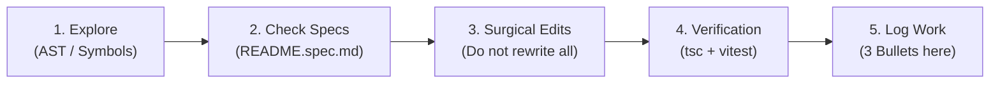

# 📋 DEV CHANGELOG & AGENT COLLABORATION GUIDELINES

This document serves as the shared log and mandatory operational guide for any developer or AI assistant (**Antigravity, Cursor, Claude Code, OpenCode**) contributing to the `vetwebappprod` repository.

---

## 🧭 Lightweight SDD Strategy (Spec-Driven Development)

To guarantee a consistent quality standard and ensure new changes never break existing, verified code, every agent or developer must adhere to this cycle:



1. **Impact inspection before editing:**
   - Locate exact symbols before modifying large files. Avoid dumping thousands of lines into context.
   - Review relevant specification files (`features/*/README.spec.md`).
2. **Respect established contracts:**
   - If a function or component already has unit tests in `__tests__/`, maintain its public signature and backward compatibility.
3. **Surgical, minimal edits:**
   - Modify only the required lines. Do not reformat entire files or alter logic unrelated to the current task.
4. **Mandatory Pre-Flight verification:**
   - No commit may be pushed without first running:
     ```bash
     npx tsc --noEmit
     npm test -- features/...
     ```
5. **Mandatory 3-bullet logging:**
   - Upon completing each task, append an entry to the **Changelog History** section following the 3-bullet template below.

---

## 📝 3-Bullet Template

Every change must be logged chronologically using this structure:

```markdown
### [YYYY-MM-DD] <Title of Change> — (@Author / AI)
- **Context / Problem:** What motivated the change or which issue was resolved.
- **Action Taken:** Modules, components, or APIs touched and the technical approach.
- **Verification:** Commands executed (`tsc`, `vitest`), branch, and deploy status.
```

---

## 🪵 Changelog History

### [2026-10-28] Live Prompt Optimization: Persona Pruning, Grounded Findings & Stage Windowing — (@Antigravity)
- **Context / Problem:** Gemini Live prompts were injecting bloated rules for all personas, irrelevant lab results, and accumulating directives from prior stages, driving up token consumption and risking clinical hallucinations.
- **Action Taken:**
  1. *Persona Pruning:* Decoupled guidelines in `systemInstructionBuilder.ts` so the pet owner receives only lay client context (removing nursing instructions and lab tables) and the nurse receives only specialized clinical directives, while strictly preserving medical disclaimer suppression (`DISCLAIMER_SUPPRESSION`).
  2. *Grounded Findings Registry:* Established strict zero-hallucination guardrails where all diagnostic findings must come from the canonical database record without inventing numbers or unconfirmed diagnoses.
  3. *Stage Windowing:* Keyed the persona switch to `${personaRoleKey}:${currentStageIndex}` in `live-session.tsx`, pushing pruned instructions on each stage transition and dropping obsolete directives from earlier stages.
- **Verification:** Clean TypeScript check (`tsc --noEmit`), 100% of `features/live` test suite passing (65/65 tests), and synchronized across active branches.

### [2026-10-28] Auto-Advance Stage on Timer Expiration & Prompt Dismissal — (@Antigravity)
- **Context / Problem:** When a stage timer ran out, if the confirmation banner ("Did you finish the Diagnostic Planning?") was still on screen, the simulation was stuck waiting for manual user interaction.
- **Action Taken:** Updated the timer expiration effect in `features/live/components/live-session.tsx` so that when time hits zero, it immediately dismisses the confirmation banner (`setShowAdvanceConfirm(false)`), auto-advances the stage via `handleConfirmAdvance()`, unmutes the microphone, and resumes simulation without forced freezes.
- **Verification:** TypeScript check passed with zero errors (`tsc --noEmit`), `features/live` test suite 100% green (65/65 tests), and branch synchronization verified.

### [2026-10-28] Gemini Live Token Analytics & Single Vercel Deploy Hook — (@Antigravity)
- **Context / Problem:** Duplicate deployments were being triggered on `preview/educators` (simultaneously by Vercel native GitHub integration and GitHub Actions webhook), and the team needed to capture Gemini Live token usage for analytics and cost monitoring.
- **Action Taken:**
  1. Adjusted `.github/workflows/deploy-preview.yml` to `workflow_dispatch` only, eliminating redundant push triggers and letting Vercel handle a single native build.
  2. Extended `GeminiLiveService` and `useGeminiLive` to capture the `usageMetadata` event from the Gemini Live socket (`promptTokenCount`, `candidatesTokenCount`).
  3. Connected `LiveSession` to transmit `promptTokens` and `completionTokens` in `PATCH /api/live/session`, persisting usage metrics into the `attempts` table with safe fallbacks for missing columns, and created the migration script `db/add_token_tracking_to_attempts.sql`.
- **Verification:** TypeScript type-check passed (`tsc --noEmit`), 49 test files passing (`npm test`), and workflow validated.

### [2026-10-28] Live Routing Unification & Legacy Chat Decommissioning — (@Antigravity)
- **Context / Problem:** When joining an educational session from `/case-sessions`, students were routed to the legacy May chat engine (`/case/[id]/attempt`) with the old Martin nurse and without live audio, due to a disconnect between the redesign sessions and the modern Live engine.
- **Action Taken:**
  1. Updated `JoinSessionDialog.tsx`, `attempt-card.tsx`, and `attempts/[id]/page.tsx` to link directly to `/live/[id]?attempt=...&session=...`.
  2. Converted `app/case/[id]/attempt/page.tsx` into a permanent auto-redirect towards `/live/[id]`, preserving all query parameters.
  3. Adapted `app/live/[id]/page.tsx` and `app/api/live/session/route.ts` to accept `attemptId` and `sessionId`, formally binding the attempt to the educator session.
  4. Decommissioned the legacy `chat-interface.tsx` monolith (5,000+ lines replaced with a lightweight redirect stub).
- **Verification:** Full unit test suite passed (185/185 unit tests green), synchronized across `preview/educators`, `preview/redesign`, and `main`.

### [2026-10-28] 20-Second Warning Ring & Clinical Reasoning Scaffolding — (@Antigravity)
- **Context / Problem:** Students lacked an eye-catching visual warning before a stage ended, and clinical reasoning scaffolding was needed based on case difficulty without generating redundant nurse personas.
- **Action Taken:**
  1. Added a pulsating red alert ring (`ring-4 ring-red-500 animate-pulse glow`) to the countdown timer in `features/live/components/live-controls.tsx` when remaining time is $\le 20$ s.
  2. Calibrated the nurse prompt in `features/role-info/services/roleInfoService.ts` to inject reflective scaffolding for Easy/Medium cases.
  3. Implemented `/api/admin/reassign-nurses` endpoint to migrate older cases to specialized nurse personas.
- **Verification:** Component tests and intensive findings integration tests verified locally and deployed to Vercel.
